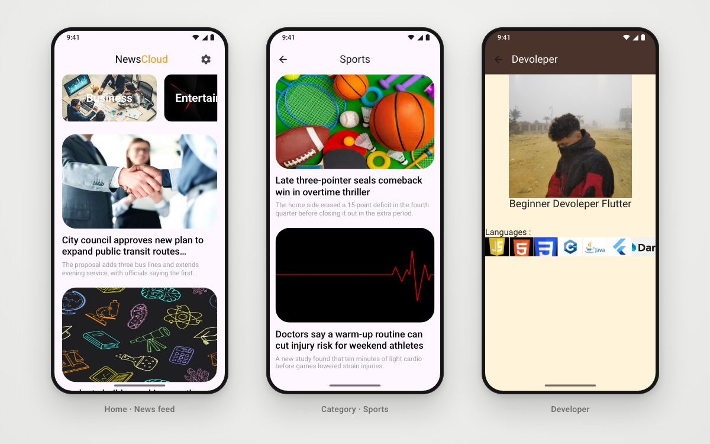

<h1 align="center">NewsCloud</h1>

<p align="center">Top US headlines by category, powered by NewsAPI and read in an in-app WebView.</p>

<p align="center">
  
  
  
  
</p>

<p align="center">
  
  <br/><sub>News feed · Category · Developer</sub>
</p>

## 📖 About

NewsCloud is a news reader built while learning REST APIs and slivers in Flutter. It fetches top US headlines from **NewsAPI** with **Dio**, lets you browse seven categories, and opens full articles in an in-app **WebView**. The home screen is a `CustomScrollView`, so the category strip and the article feed scroll together.

## ✨ Features

- 🗂 **Seven categories**: Business, Entertainment, Health, Science, Sports, Technology and General, each as an image card in a horizontal list.
- 👉 **Category pages**: tap a category card to open a feed filtered to it.
- 📰 **Headline feed**: image, title and description for each article, loaded with `FutureBuilder` and showing loading and error states.
- 🌐 **In-app reading**: tap an article to open it in `webview_flutter`.
- 🧱 **Sliver layout**: `CustomScrollView` with `SliverToBoxAdapter` and a sliver list for smooth scrolling.
- 👤 **Developer page** opened from the app bar.

## 🛠 Tech stack

- **Flutter / Dart** (SDK `>=3.4.3 <4.0.0`)
- **dio**: HTTP client for NewsAPI `top-headlines`
- **webview_flutter**: in-app article reader
- `FutureBuilder` for async state

## 🏗 Project structure

```
lib/
├── Models/      # ArticleModel, CategorsModel
├── services/    # NewsServices (Dio → NewsAPI)
├── pages/       # home, category view, WebView, developer
├── widgets/     # category cards/list, news card/list, list builder
└── main.dart
assets/          # category images, developer images
```

## 🚀 Getting started

```bash
git clone https://github.com/youssef336/news_app.git
cd news_app
flutter pub get
flutter run
```

**API key:** the request URL is in `lib/services/News_services.dart`. Get your own free key at [newsapi.org](https://newsapi.org) and put it in the `apiKey` query parameter.

## 👤 Author

**Youssef Belal Zakaria** · [GitHub @youssef336](https://github.com/youssef336)

⭐ If you like this project, give it a star!
